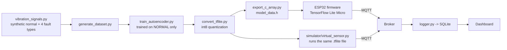

# Edge AI TinyML — Vibration Anomaly Detection

An ESP32 + accelerometer runs a **quantized autoencoder** locally to detect
abnormal machine vibration (bearing wear, imbalance, misalignment,
looseness) — the kind of predictive-maintenance system that watches
rotating machinery without needing a single labeled fault example, and
without sending raw data anywhere for a cloud model to judge. Companion
project to [esp32-smart-agriculture](https://github.com/generalhama27-oss/esp32-smart-agriculture),
reusing its MQTT + dashboard architecture for a system built around Edge AI
instead of rule-based automation.


> 📸 **Photos & demo video go here.** The most convincing single clip:
> start the dashboard, run the simulator, and let a fault-injection window
> play out live — watch the anomaly score spike well above the threshold
> line and the alert flip to 🚨 within one sampling window.

## Why an autoencoder, not a classifier

A classifier needs labeled examples of every fault type it should
recognize — expensive and impractical for real machinery, where you
usually have plenty of "normal" data and very few (or zero) recorded
failures. An **autoencoder trained only on normal vibration** learns to
reconstruct normal patterns well; anything it hasn't seen (any fault,
known or not) reconstructs poorly. This is the standard approach used in
real industrial condition-monitoring systems, and it's why the model in
this project never sees a single anomalous window during training.

## An honest note on how this project was validated

| Validated | How |
|---|---|
| Signal generation (4 fault signatures statistically distinct from normal) | 9 unit tests |
| Autoencoder training + anomaly separation | 5 unit tests, trained on a real (small, fast) dataset |
| **Quantization doesn't degrade detection** | 3 unit tests running actual int8 inference through the converted `.tflite` model and re-checking recall/false-positive rate |
| MQTT pipeline (simulator running the *real* trained model -> broker -> logger -> dashboard) | 3 integration tests against a real Mosquitto broker subprocess, 7 logger unit tests |
| Dashboard | Streamlit's headless test runner + a live broker |
| **The real ESP32 firmware (TensorFlow Lite Micro)** | **Not compiled or flashed** - same limitation as the other two ESP32 projects in this series: this sandbox can't reach the Arduino/Espressif toolchain. Written carefully against the TFLM API, but you are its first compiler. |

**On the simulated data, stated plainly:** the vibration signals are a
simplified model of common fault *shapes* (see
`simulator/vibration_signals.py`'s docstring) at a scale convenient for a
fast demo (200Hz, 64-sample windows) - not a physically calibrated,
certified condition-monitoring instrument. What's real and fully tested is
the ML pipeline: train, quantize, verify accuracy survives quantization,
deploy. That pipeline is identical regardless of where the training data
ultimately comes from - point `data/generate_dataset.py` at real recorded
accelerometer data and the rest of the pipeline doesn't change.

## Pipeline



## Results

| Stage | Model size | False positive rate | Recall |
|---|---|---|---|
| Float32 (Keras) | - | 1.0% | 100% |
| **Quantized int8 (deployed)** | **11.4 KB** | 1.0% | 100% |

(Numbers from the full training run in `model/artifacts/threshold_quant.json`
- your numbers may vary slightly with a different random seed, but the
gap between normal and anomaly reconstruction error is large by design:
quantization noise is nowhere close to closing it.)

## MQTT topic scheme

| Topic | Payload |
|---|---|
| `machine/<device_id>/status` | retained `online`/`offline` (LWT) |
| `machine/<device_id>/vibration/rms` | root-mean-square amplitude of the window |
| `machine/<device_id>/vibration/anomaly_score` | reconstruction MSE from the autoencoder |
| `machine/<device_id>/vibration/alert` | retained `0`/`1` |
| `machine/<device_id>/debug/fault_type` | **simulator only** - ground truth being injected, for demo purposes |

## Installation

```bash
git clone https://github.com/generalhama27-oss/esp32-tinyml-anomaly-detection.git
cd esp32-tinyml-anomaly-detection
python -m venv venv && source venv/bin/activate
pip install -r requirements.txt

sudo apt install mosquitto mosquitto-clients     # or: brew install mosquitto
mosquitto -v
```

## Running the ML pipeline from scratch

```bash
python data/generate_dataset.py            # -> data/dataset.npz
python model/train_autoencoder.py          # -> model/artifacts/autoencoder.keras, threshold.json
python model/convert_tflite.py             # -> model/artifacts/model_quant.tflite, threshold_quant.json
python model/export_c_array.py             # -> model/artifacts/model_data.h, model_params.h
```

`model/artifacts/` already ships with a trained model, so you can skip
straight to running the demo below if you just want to see it work.

## Running the full demo (no hardware needed)

In separate terminals:

```bash
python backend/logger.py --db vibration_data.sqlite3
python simulator/virtual_sensor.py            # runs the REAL model_quant.tflite file
streamlit run dashboard/app.py
```

**Just want to see the dashboard immediately?** Point it at
`examples/demo_vibration_data.sqlite3` in the sidebar - it already
contains a mix of normal and detected-anomaly readings.

## Real hardware setup

Wiring: MPU6050 SDA -> GPIO21, SCL -> GPIO22 (default ESP32 I2C pins).

1. Copy `firmware/esp32_tinyml_anomaly/config.h.example` to `config.h` and
   fill in your WiFi + broker details.
2. Install the Arduino libraries listed at the top of the `.ino` (Adafruit
   MPU6050, PubSubClient, and a TensorFlow Lite Micro port for ESP32 -
   `esp-tflite-micro` is what this sketch was written against).
3. `model_data.h` and `model_params.h` are already copied into the
   firmware folder from `model/artifacts/` - regenerate and re-copy them
   if you retrain the model.
4. Flash, then point `backend/logger.py` / `dashboard/app.py` at the same
   broker - the dashboard shows the real device instead of the simulator
   with zero code changes, since both speak the same MQTT topic scheme
   and both run the exact same `.tflite` file.

## Project structure

```
esp32-tinyml-anomaly-detection/
├── data/generate_dataset.py
├── model/
│   ├── train_autoencoder.py
│   ├── convert_tflite.py
│   ├── export_c_array.py
│   └── artifacts/               # autoencoder.keras, model_quant.tflite, model_data.h, ...
├── simulator/
│   ├── vibration_signals.py     # shared signal model (training + simulator)
│   ├── anomaly_detector.py      # loads model_quant.tflite, scores windows
│   └── virtual_sensor.py        # stands in for the ESP32
├── backend/
│   ├── mqtt_topics.py
│   └── logger.py
├── dashboard/app.py
├── firmware/esp32_tinyml_anomaly/
│   ├── esp32_tinyml_anomaly.ino  # real firmware (untested here, see note above)
│   ├── model_data.h / model_params.h
│   └── config.h.example
├── examples/demo_vibration_data.sqlite3
├── tests/
│   ├── test_vibration_signals.py
│   ├── test_train_autoencoder.py
│   ├── test_convert_tflite.py
│   ├── test_logger.py
│   └── test_integration.py
├── requirements.txt
└── LICENSE
```

## Testing

```bash
pytest tests/ -v
```

27 tests: signal generation statistics, autoencoder training and
normal/anomaly separation, **quantized-model detection accuracy** (the
test that actually matters for a deployable TinyML model), the MQTT
logger, and 3 end-to-end integration tests against a real Mosquitto
broker running the real trained model.

## About

Built by **Tahirou Daouda Mahamadou** — Embedded Systems Engineer specializing
in automotive diagnostics (CAN/UDS), IoT, and Edge AI / test automation.
[LinkedIn](#) · [Upwork](#) · tahiroumahamadoudaouda@gmail.com

## License

MIT — see [LICENSE](LICENSE).
